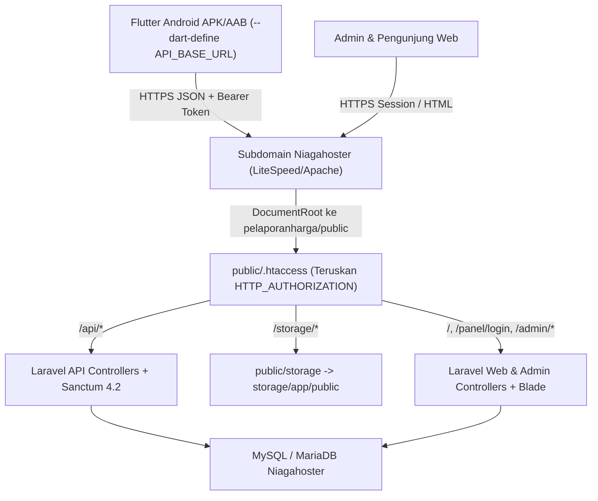
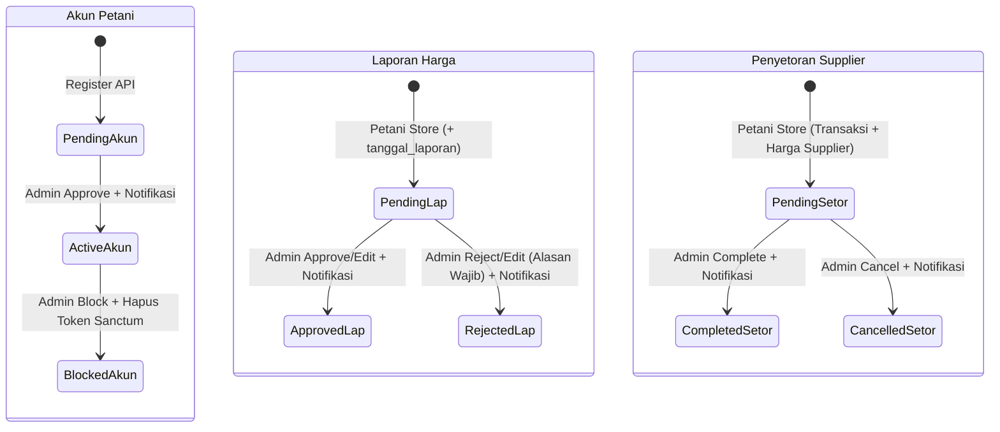
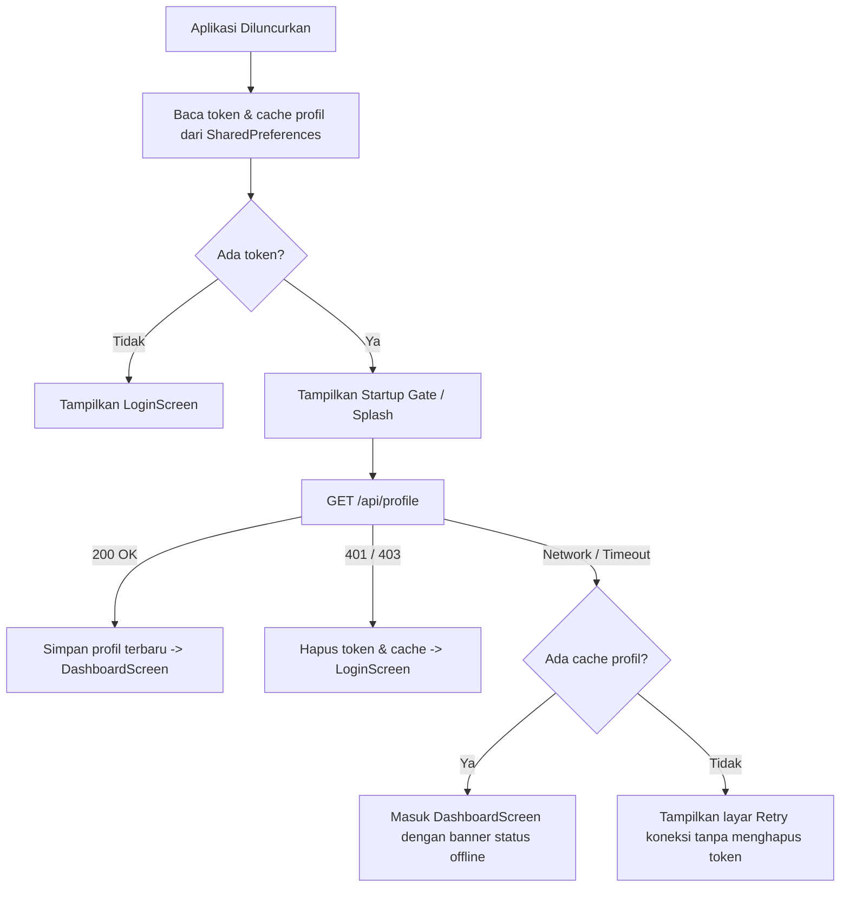

# Stabilisasi Alur, Perbaikan UI UX, dan Kesiapan Publikasi Pelaporan Harga - Plan

## Goal Capsule

- **Objective:** Memastikan seluruh alur pelaporan harga komoditas, moderasi admin, pemantauan harga publik, serta pencatatan penyetoran dan rating supplier berjalan bebas bug di sisi backend Laravel dan aplikasi Android Flutter, memenuhi standar kontras dan keterbacaan UI UX lintas ukuran layar, serta siap dipublikasikan ke subdomain Niagahoster dengan database MySQL dan rilis Android APK/AAB.
- **Means:** Perbaikan terarah pada skema migrasi MySQL, validasi dan otorisasi API/Web, perbaikan state management dan form Flutter, penyesuaian kontras WCAG AA tanpa perombakan fitur di luar lingkup, serta konfigurasi rilis produksi dan suite pengujian otomatis (KTD1, KTD2).
- **Authority:** Aturan produk dikunci di `## Product Contract` (`R1`..`R20`), mekanisme teknis dikunci di `## Planning Contract` (`KTD1`..`KTD7`), dan batasan lingkup mengikuti konfirmasi pengguna di sesi perencanaan.
- **Stop Conditions:** Tidak menambah role login supplier baru, tidak mengubah arsitektur menjadi layanan microservices/cloud storage eksternal, dan tidak merilis ke Play Store sebelum konfigurasi signing/applicationId serta Smoke Test server produksi lulus.
- **Execution Profile:** Single PR (`1 PR`) yang menyatukan seluruh unit `U1`..`U8` dalam urutan dependensi migrasi, keamanan API, panel admin, inti Flutter, layar Flutter, aksesibilitas UI, dan konfigurasi publikasi; diselesaikan penuh dalam siklus implementasi dan review sebelum publikasi.

---

## Product Contract

### Summary

Proyek ini terdiri atas backend web/API `pelaporanharga` (Laravel 12, Sanctum 4.2, Bootstrap 5.3 via CDN) dan aplikasi mobile `pelaporan_harga_petani` (Flutter/Dart, Provider, Dio) untuk mendata laporan harga panen petani, menampilkannya secara publik sebagai pembanding antarwilayah, serta mencatat rencana penyetoran dan rating supplier binaan admin. Saat ini struktur utama sudah berjalan di lingkungan lokal SQLite, tetapi menyimpan sejumlah cacat kritis yang menggagalkan migrasi MySQL di shared hosting, memutus beberapa alur UI (edit laporan, manajemen penyetoran, CRUD master data tertentu, startup offline), mengandung risiko keamanan upload dan DOM XSS, serta melanggar standar kontras WCAG AA. Rencana ini menutup seluruh celah tersebut secara minimal, teruji, dan siap dipublikasikan ke subdomain Niagahoster tanpa menambah fitur baru yang melebar.

### Problem Frame

Analisis menyeluruh pada kode sumber `pelaporanharga` dan `pelaporan_harga_petani` menemukan empat kelompok kendala utama yang menghambat publikasi:
1. Ketidakcocokan infrastruktur MySQL dan rilis Android: tabel `laporan_harga` dibuat lebih awal daripada tabel `wilayah` yang direferensikan oleh foreign key, kolom `tanggal_laporan` memakai `default(now())` yang ditolak MySQL strict mode, `baseUrl` Flutter mengarah permanen ke IP LAN lokal, serta `AndroidManifest.xml` belum mendeklarasikan izin `INTERNET` untuk build release.
2. Alur kerja terputus atau macet: petani tidak melihat nilai wilayah/komoditas sebelumnya saat mengedit laporan pending, modul penyetoran hanya berstatus `pending` tanpa aksi penyelesaian dari admin maupun filter `cancelled` di mobile, pemblokiran petani tidak mencabut token Sanctum aktif, dan pembaruan status via edit laporan admin tidak mengirim notifikasi.
3. Cacat keamanan, integritas data, dan performa query: upload foto base64 menerima ekstensi sembarang dan menghapus foto lama jika field `foto` dikirim kosong/null, endpoint penyetoran mempercayai `satuan` dari payload client tanpa menyamakannya dengan harga supplier, rating supplier tidak terikat anti-duplikasi, publik HTML menyusun markup lewat string interpolation tanpa escaping, serta agregasi harga publik memicu query N+1 berulang kali.
4. Kendala UI/UX dan runtime widget Flutter: pemanggilan `initReferenceData()` di dalam `build()` berisiko memicu exception rebuild, startup app memflash `LoginScreen` lalu me-logout paksa saat offline, filter kosong pada dashboard menyembunyikan search bar sehingga pengguna terjebak, modal rating tertutup keyboard, serta sejumlah teks badge/harga/label gagal kontras minimum 4.5:1.

### Key Decisions

- Pertahankan arsitektur Supplier dikelola Admin tanpa portal login role supplier baru `(session-settled: user-approved -- chosen over Opsi 2 role supplier terpisah in INSIGHT_FITUR_SUPPLIER.md: mencegah pelebaran kompleksitas auth agar proyek stabil dan cepat siap rilis)` Governs R5, R7.
- Target hosting adalah Shared/Cloud Hosting Niagahoster menggunakan PHP 8.2+, Apache/LiteSpeed `.htaccess`, dan MySQL/MariaDB tanpa dependensi VPS/Docker/Node server runtime `(session-settled: user-approved -- chosen over standalone VPS deployment: menyesuaikan paket Niagahoster reguler via hPanel/cPanel)` Governs R1, R17, R18.
- Target publikasi mobile difokuskan pada rilis Android (APK / AAB Play Store) dengan tata letak aman di berbagai ukuran layar ponsel `(session-settled: user-approved -- chosen over dual iOS+Android simultaneous store release: menjaga fokus verifikasi dan konfigurasi rilis di target Android terlebih dahulu)` Governs R10, R15, R19.
- Perbaikan UI/UX difokuskan pada kejelasan alur, keterbacaan kontras WCAG AA, responsivitas tanpa overflow, serta status loading/empty/error yang jelas tanpa merancang ulang identitas visual dari nol `(session-settled: user-approved -- chosen over full visual brand overhaul: mematuhi batasan tidak mengembangkan proyek terlalu jauh)` Governs R11, R12, R13, R14.

### Actors

- A1. **Petani:** Pengguna aplikasi Flutter yang mendaftar, menunggu persetujuan admin, melaporkan harga panen beserta foto opsional, memantau harga pasar antarwilayah, mencatat penyetoran panen ke supplier, memberi rating/ulasan, dan menerima notifikasi status.
- A2. **Admin:** Pengelola melalui web browser (panel `/admin/*`) yang memverifikasi akun petani, memoderasi laporan harga (approve/reject/edit), mengelola master wilayah/komoditas/supplier, memproses status penyetoran, mengirim broadcast, dan memantau statistik.
- A3. **Pengunjung Publik:** Pengguna umum tanpa login yang mengakses halaman utama subdomain (`/`) atau endpoint publik untuk membandingkan harga komoditas terkini dan grafik tren.
- A4. **Operator / Publisher:** Pemilik proyek yang melakukan deployment backend Laravel ke subdomain Niagahoster serta membangun/menandatangani Android APK/AAB untuk distribusi.

### Key Flows

- F1. **Registrasi, Login, dan Ketahanan Sesi Offline Petani**
  - **Trigger:** Petani membuka aplikasi Android atau mengirim form registrasi/login.
  - **Actors:** A1, A2
  - **Steps:** Aplikasi menampilkan gate startup sampai status token tersimpan terbaca; jika offline saat validasi profil awal, sesi lokal tetap dipertahankan dengan opsi muat ulang; jika token tidak valid (HTTP 401/403) atau diblokir admin (`status: blocked` + token dicabut), sesi dibersihkan dan diarahkan ke login; login dengan role selain petani di endpoint mobile ditolak secara informatif.
  - **Covered by:** R3, R4, R10
- F2. **Pembuatan, Edit, dan Moderasi Laporan Harga**
  - **Trigger:** Petani membuat atau mengubah laporan berstatus `pending`, lalu admin memoderasi di panel web.
  - **Actors:** A1, A2
  - **Steps:** Form Flutter mengisi nilai wilayah, komoditas, dan foto yang sudah ada saat mode edit; payload divalidasi (`harga > 0`, mime foto valid, batas ukuran file); `tanggal_laporan` diset otomatis di backend; admin melihat foto bukti dan alasan penolakan di modal/halaman detail serta saat mengubah status ke `approved`/`rejected` lewat tombol aksi maupun halaman edit, sistem selalu mengirim notifikasi konsisten.
  - **Covered by:** R2, R4, R6, R11, R12
- F3. **Penyetoran Panen dan Rating Supplier**
  - **Trigger:** Petani memilih supplier aktif, mencatat penyetoran komoditas, lalu admin memproses transaksi dan petani memberi ulasan.
  - **Actors:** A1, A2
  - **Steps:** Form Flutter memakai komoditas aktif dan satuan resmi supplier; backend menghitung `total_nilai` dalam transaksi memakai `harga_per_satuan` dan `satuan` milik `SupplierHarga` serta mengembalikan ID penyetoran; modal rating menerima inset keyboard dan menyertakan `penyetoran_id` tanpa mengizinkan duplikasi rating untuk transaksi yang sama; admin dapat mengubah status penyetoran dari `pending` ke `completed` atau `cancelled` sehingga riwayat petani di Flutter akurat.
  - **Covered by:** R5, R7, R13
- F4. **Pemantauan Harga Pasar Publik dan Statistik Admin**
  - **Trigger:** Pengunjung membuka `/` atau petani membuka layar Harga Pasar; admin membuka `/admin/statistik`.
  - **Actors:** A1, A2, A3
  - **Steps:** Backend mengagregasi harga terkini per pasangan `(komoditas, satuan)` dan tren secara efisien tanpa N+1 query; frontend web me-render teks ter-escape tanpa `innerHTML` mentah; Flutter memakai `LayoutBuilder` agar slider posisi harga dan kartu tidak overflow serta menampilkan `satuan` sebenarnya alih-alih hardcoded `/kg`.
  - **Covered by:** R8, R9, R13, R14, R15

### Requirements

**Infrastruktur Data dan Kompatibilitas MySQL**
- R1. Seluruh migrasi Laravel wajib berhasil dijalankan berurutan (`migrate:fresh`) pada database MySQL/MariaDB strict mode maupun SQLite test tanpa error foreign key ordering atau invalid `DATE` default expression, memperlebar kolom `laporan_harga.harga` ke `decimal(15, 2)`, menambah indeks `UNIQUE` pada `supplier_rating.penyetoran_id`, menyetel default timezone aplikasi ke `Asia/Jakarta` (`env('APP_TIMEZONE', 'Asia/Jakarta')`), serta menjaga kompatibilitas panjang string indeks (`191`).
- R2. Setiap `LaporanHarga` baru yang dibuat melalui API wajib terisi `tanggal_laporan` secara eksplisit di backend (`now()->toDateString()`) memakai timezone aplikasi yang selaras dengan perangkat petani alih-alih bergantung pada nilai default kolom database.

**Keamanan API, Validasi Input, dan Otorisasi**
- R3. Pemblokiran akun petani oleh admin (`UserAdminController::block`) wajib sekaligus mencabut seluruh Sanctum token milik user tersebut; `RoleMiddleware`, `/api/profile`, dan `POST /panel/login` wajib memverifikasi `isActive()`; endpoint `/api/login` wajib memeriksa `role === 'petani'` dan status `pending` vs `blocked` secara terstruktur setelah verifikasi sandi `Hash::check()` (dengan penguncian transaksi sebelum menerbitkan token); serta endpoint login web/API dan registrasi wajib dilindungi rate limiter (`throttle:login`, `throttle:register`).
- R4. Validasi upload foto laporan wajib membatasi dimensi unggahan di klien (`maxWidth: 1024`, `maxHeight: 1024`) dan batas ukuran (`<= 2 MB`), membatasi panjang string base64 mentah (`max:3000000`), memeriksa byte gambar sah (`jpg`, `png`, `webp`) lewat `base64_decode(..., true)` strict dan `getimagesizefromstring()`, menyimpan gambar baru terlebih dahulu sebelum menghapus `foto_path` lama saat `update`, serta mempertahankan foto lama bila `update` tidak mengirim foto baru atau mengirim `foto: null`.
- R5. Endpoint `PenyetoranController::store` wajib mempertahankan struktur paginator root pada `index()` disertai flag `has_rating`, mengunci perhitungan `store()` menggunakan `harga_per_satuan` dan `satuan` dari `SupplierHarga` dalam `DB::transaction`, menolak jumlah/harga `<= 0`, mengembalikan `data.id`, serta endpoint rating mewajibkan `penyetoran_id` milik petani yang bersangkutan (status non-`cancelled`), mencegah duplikasi baik di validasi maupun indeks `UNIQUE` database (`422`), dan mengizinkan petani mengirim rating sekali per transaksi selesai dari `PenyetoranListScreen`.
- R6. Endpoint web dan API wajib memvalidasi `harga` (`gt:0`, `max:999999999999.99`), mewajibkan `rejection_reason` ketika status diset ke `rejected`, memindahkan nama route `api.public.harga-terkini` ke `routes/api.php` sebelum menghapus route duplikat di `routes/web.php`, dan mengganti seluruh route Closure di `routes/web.php` menjadi controller/redirect agar `php artisan route:cache` berhasil.

**Kelengkapan Alur Panel Admin dan Harga Publik**
- R7. Panel admin wajib menyediakan aksi pembaruan status penyetoran (`pending` -> `completed` atau `cancelled`) beserta notifikasi ke petani terkait agar alur penyetoran tidak berhenti permanen pada status `pending`.
- R8. Seluruh alur CRUD master data admin (`Komoditas`, `Wilayah`, `Supplier`) wajib mengunci route `komoditas`/`wilayah` dengan `except(['show', 'create', 'edit'])` dan menghapus method `create()`/`edit()` mati, bebas dari bug toggle `is_active` pada form create, memblokir penghapusan data yang masih direferensikan oleh `penyetoran`, `supplier_harga`, atau `suppliers`, memakai `data-action` berbasis `route()` alih-alih path hardcoded dan inline JSON `onclick`, serta mempertahankan `old()` dan alert `@if($errors->any())` saat validasi modal gagal.
- R9. Query agregasi harga publik (`PublicController::getLatestApprovedPrices`), daftar supplier API dan Admin (`SupplierController::index`), serta statistik admin (`StatistikController::index`) wajib bebas N+1 query (`withAvg` / query batch), mengelompokkan pembanding harga publik berdasarkan pasangan `(komoditas_id, strtolower(satuan))` agar `min/max/slider` dan badge `Termurah`/`Termahal` akurat per satuan, meneruskan filter aktif saat live polling statistik, aman terhadap relasi null (`$pk->komoditas?->grade`), dan meng-clamp parameter `periode` (`7..90`).

**Stabilitas dan Ketahanan Aplikasi Flutter**
- R10. Alur startup Flutter wajib menggunakan status inisialisasi eksplisit dan navigasi deklaratif dari root `MyApp` dengan `GlobalKey<NavigatorState>` (tanpa `pushReplacementNamed` yang menyingkirkan `Consumer<AuthProvider>`), memisahkan `clearSession()` lokal dari request jaringan `POST /api/logout`, menampilkan Retry Gate offline (`Coba Lagi` + `Keluar / Ganti Akun`) di `SplashScreen` saat belum ada profil cache, memulihkan sesi cache dengan banner offline persisten di `DashboardScreen` bila jaringan gagal, serta hanya menghapus token pada HTTP `401`/`403`.
- R11. Error parsing di `LaporanProvider` wajib menangkap `ValidationException` sebelum `ApiException` serta memisahkan `laporanErrorMessage` dan `referenceErrorMessage` agar load paralel tidak saling menimpa; `PenyetoranProvider` dan `NotificationProvider` wajib mengekspos error dan menampilkannya bersama aksi retry (termasuk inline error bar saat daftar tidak kosong).
- R12. Form pembuatan dan edit laporan (`CreateLaporanScreen`) wajib mengisi ulang `Wilayah`, `Komoditas`, dan pratinjau `fotoPath` saat mode edit, menampilkan modal bottom sheet dengan header (`Buat/Edit Laporan` + tombol tutup `>= 44px`), padding inset keyboard, pesan error/retry referensi inline agar tidak tertutup parent scaffold, memperbarui label `Harga per <satuan>` secara reaktif, memvalidasi `harga > 0` (dan batas wajar), serta menjaga search/filter bar `DashboardScreen` di luar state loading/error/empty sambil menangkap parent context/navigator sebelum `Navigator.pop()` modal.
- R13. Layar `HargaPublikScreen` dan `SupplierListScreen` dilarang memanggil `initReferenceData()` di dalam `build()`; slider pembanding harga memakai `LayoutBuilder`, seluruh harga memakai `NumberFormat('#,##0', 'id_ID')` serta tanggal `tryParse` + `.toLocal()`, dropdown filter di `HargaPublikScreen`/`SupplierListScreen`/`SupplierDetailScreen` memakai `isExpanded: true`, `PenyetoranListScreen` mendukung status `pending`/`completed`/`cancelled` terlokalisasi + tombol `Beri Rating`, `SupplierDetailScreen` menampilkan satuan di label `Jumlah (<satuan>)` + estimasi total + guard stok harga kosong, serta modal rating memakai keyboard inset padding, reset state, tap lock `_submittingRating`, dan inline error handling.

**Kepatuhan UI/UX Anti-Slop, Kontras WCAG AA, dan Responsivitas**
- R14. Seluruh teks, badge status (`Approved`, `Pending`, `Rejected`, `Completed`, `Cancelled`, `Termurah`, `Termahal`), kartu/badge Bootstrap web (`.badge.bg-warning`, `.card.bg-warning`, `.badge.bg-info`, `.card.bg-info`, `.text-warning` bintang, label `.opacity-75`), label abu-abu sekunder Flutter (`#616161` minimum agar lolos di `#FFFFFF`/`#FAFAFA`/`#F5F5F5`/`#EEEEEE`), dan bintang rating (`#B45309`) wajib memenuhi rasio kontras WCAG AA minimum `>= 4.5:1` pada `contrast-check.py`; gradient ungu login admin dan teks kredensial demo di `admin/auth/login.blade.php` dihapus; markup JS di `public/index.blade.php` aman dari XSS dan menampilkan `satuan` dinamis.
- R15. Seluruh kontrol interaktif memiliki area sentuh memadai (`>= 44px`, termasuk toggle password di `CustomTextField`, tombol tutup modal, dan tautan Daftar), AppBar `DashboardScreen` menghapus ikon duplikat dengan judul `ellipsis`, tidak ada baris kartu/tabel/dropdown yang memicu horizontal overflow pada layar ponsel `320px-360px` (termasuk pembungkusan `RefreshIndicator` di state kosong terfilter dan tombol `Reset Filter`), animasi `pulse` berulang (di `public/index.blade.php` maupun `.live-badge` pada `admin/statistik/index.blade.php`) dan seluruh em dash dihapus, serta istilah teknis (`Filter live`, port `8000`, status mentah bahasa Inggris) diganti bahasa pengguna Indonesia.
- R16. Grafik dan tabel statistik/dashboard kosong wajib menampilkan empty state bermakna, dan dependensi `pubspec.yaml` yang tidak terpakai (`google_fonts`, `flutter_svg`, `dropdown_button2`, `shimmer`) dibersihkan agar ukuran build rilis minimal dan aman offline.

**Kesiapan Deployment Niagahoster dan Publikasi Android**
- R17. Konfigurasi backend mendukung produksi Niagahoster subdomain di belakang HTTPS/reverse proxy (`trustProxies` dengan `env('TRUSTED_PROXIES', '*')` tanpa `HEADER_X_FORWARDED_HOST`, conditional `URL::forceScheme('https')`, opsional `PUBLIC_PATH` via `App::usePublicPath()`, `CORS_ALLOWED_ORIGINS` non-wildcard di `.env.production.example`, casting aman `(int)` untuk `SANCTUM_TOKEN_EXPIRATION` pada Carbon 3), serta prosedur pre-bundled `vendor/` tanpa butuh Composer CLI di server.
- R18. Proyek menyertakan panduan deployment Niagahoster subdomain (`pelaporanharga/DEPLOYMENT_NIAGAHOSTER.md`) untuk Shared/Cloud Hosting (hPanel/cPanel), penyiapan database MySQL, pembuatan symlink `storage` melalui Terminal hPanel atau Cron Job sekali jalan tanpa skrip PHP publik, dan pengisian data supplier nyata lewat panel admin.
- R19. Proyek menyertakan panduan build Android (`pelaporan_harga_petani/RELEASE_ANDROID.md`), deklarasi `android.permission.INTERNET`, `android:allowBackup="false"`, `android:label` layak publik pada `AndroidManifest.xml`, dukungan `--dart-define=API_BASE_URL=...`, pemisahan konfigurasi `applicationId` dan signing key standar `android/key.properties`, serta pengaman Gradle yang menggagalkan build release bila `key.properties` hilang atau `applicationId` masih `com.example.*` (kecuali flag eksplisit `-PallowDebugRelease=true` untuk smoke compile).

**Verifikasi Otomatis**
- R20. Proyek wajib dilengkapi test suite otomatis PHPUnit/Laravel Feature Tests dan Flutter unit/widget tests untuk seluruh alur kritis yang diperbaiki.

### Acceptance Examples

- AE1. **Migrasi MySQL Segar Berhasil**
  - Covers R1, R2
  - Given database MySQL 8.0/MariaDB kosong dengan mode `STRICT_TRANS_TABLES`,
  - When `php artisan migrate --seed` dijalankan lalu petani mengirim `POST /api/petani/laporan` tanpa field `tanggal_laporan`,
  - Then seluruh tabel dan foreign key terbuat tanpa error dan baris baru `laporan_harga` memiliki `tanggal_laporan` tanggal hari ini.
- AE2. **Blokir Petani Memutus Akses API Seketika**
  - Covers R3
  - Given petani A memegang Bearer token aktif,
  - When admin menjalankan `POST /admin/users/petani/{id}/block`,
  - Then token Sanctum petani A dihapus dari tabel `personal_access_tokens` dan request berikutnya ke `GET /api/petani/laporan` langsung mengembalikan HTTP 401.
- AE3. **Edit Laporan Pending Mempertahankan Nilai Sebelumnya**
  - Covers R4, R12
  - Given petani membuka `LaporanDetailScreen` untuk laporan berstatus `pending` yang memiliki wilayah X, komoditas Y, dan `foto_path` terunggah,
  - When petani menekan Edit lalu hanya mengubah harga tanpa menyentuh dropdown atau foto,
  - Then dropdown wilayah X dan komoditas Y sudah terpilih sejak awal, preview foto lama tampil, dan sesudah disimpan `foto_path` di database tetap ada tanpa terhapus.
- AE4. **Filter Dashboard Kosong Tidak Mengunci Pengguna**
  - Covers R12, R15
  - Given petani berada di `DashboardScreen` yang memiliki daftar laporan,
  - When petani mengetik kata kunci pencarian atau memilih status yang hasilnya 0 item,
  - Then kolom pencarian, dropdown filter, dan tombol reset filter tetap terlihat dan dapat ditekan di bagian atas layar sementara area daftar menampilkan empty state.
- AE5. **Penyetoran Panen Selesai oleh Admin**
  - Covers R5, R7, R13
  - Given petani mencatat penyetoran 100 kg pada supplier dengan harga Rp 10.000/kg,
  - When payload menyertakan komoditas valid, sistem mengunci `satuan = kg` dan `total_nilai = 1000000` lalu mengembalikan ID penyetoran, admin mengubah status penyetoran ke `completed`, dan petani membuka `PenyetoranListScreen` serta mengirim rating sekali,
  - Then petani menerima notifikasi status `completed`, dapat memfilter `completed`/`cancelled`, dan percobaan rating kedua pada `penyetoran_id` yang sama ditolak 422.
- AE6. **Sesi Flutter Bertahan Saat Offline**
  - Covers R10
  - Given petani sebelumnya sudah login dan memiliki token tersimpan di `SharedPreferences`,
  - When ponsel dibuka dalam kondisi offline (network timeout/socket exception),
  - Then `AuthProvider.init()` tidak memanggil `logout()`, token tetap tersimpan, dan UI menampilkan status offline dengan tombol Coba Lagi alih-alih menghapus sesi pengguna.
- AE7. **Release APK Terhubung ke Subdomain HTTPS**
  - Covers R17, R19
  - Given backend sudah berjalan di `https://harga.domain.com` dan APK dibangun dengan `--dart-define=API_BASE_URL=https://harga.domain.com/api`,
  - When APK rilis dipasang di perangkat Android fisik,
  - Then izin `INTERNET` aktif di `AndroidManifest.xml`, login, unggah foto laporan, pembacaan foto storage, dan filter harga berjalan tanpa error koneksi atau CORS.

### Success Criteria

- 100% test PHPUnit Feature & Unit serta `flutter test` dan `flutter analyze` lulus tanpa warning/error baru.
- 0 pasangan warna teks dan latar utama yang berada di bawah rasio kontras 4.5:1 pada pemeriksaan `contrast-check.py`.
- 0 query N+1 berulang per kombinasi wilayah-komoditas pada `PublicController` atau per baris petani pada `StatistikController`.
- Seluruh alur CRUD admin, moderasi laporan, penyetoran, dan alur mobile petani terverifikasi berjalan di database MySQL strict mode sebelum rilis.

### Scope Boundaries

**Considered and Not Built**
- **Portal Login/Dashboard Khusus Role Supplier:** Tidak dibangun karena mengikuti kesepakatan lingkup saat ini bahwa Supplier cukup dikelola oleh Admin (memelihara kesederhanaan arsitektur). Akan dipertimbangkan hanya jika mitra penggilingan/koperasi nantinya membutuhkan input stok dan update status penyetoran mandiri.
- **Penyimpanan Cloud Eksternal (S3/Cloudinary) dan Push Notification (FCM):** Tidak dibangun karena foto laporan berukuran kecil (`<= 2MB`) dan notifikasi via database polling sudah mencukupi kebutuhan operasional saat ini di shared hosting tanpa biaya layanan pihak ketiga.
- **Sinkronisasi Tulis Offline (Offline SQLite Write Queue):** Tidak dibangun untuk menghindari kompleksitas resolusi konflik data harga antarperangkat; ketahanan offline dibatasi pada pemeliharaan sesi login dan Retry UI yang jelas.

**Deferred to Follow-Up Work**
- Pembuatan aset visual launcher icon aplikasi Android custom atau ilustrasi khusus (perlu persetujuan dan aset desain pemilik proyek sebelum dibuat).
- Konfigurasi build dan publikasi khusus platform iOS (`Runner.xcworkspace`, sertifikat Apple Developer).
- Pembuatan akun dan proses submission listing pada Google Play Console setelah APK/AAB tertandatangani siap uji.

---

## Planning Contract

### Key Technical Decisions

- KTD1. **Perbaikan Urutan Migrasi dan Skema Aman MySQL di Awal (`U1`):** Memindahkan definisi atau timestamp migrasi `wilayah` agar berjalan sebelum `laporan_harga` dan mengganti `->default(now())` pada `tanggal_laporan` menjadi nullable/tanpa default dinamis serta mengisi tanggal di aplikasi (`LaporanController::store`), daripada mematikan MySQL `STRICT_ALL_TABLES` di server hosting yang tidak selalu diizinkan oleh shared hosting.
- KTD2. **Konfigurasi Environment Build-Time Flutter Via `--dart-define` (`U4`, `U8`):** Menggunakan `const String.fromEnvironment('API_BASE_URL', defaultValue: ...)` di `ApiConstants` daripada membuat layar pengaturan URL manual atau hardcode domain di repo, agar APK produksi dan build dev memakai satu basis kode bersih tanpa kebocoran alamat IP internal.
- KTD3. **Penyederhanaan CRUD Komoditas dan Wilayah Memakai Modal Terpadu (`U3`):** Mengunci resource route `wilayah` dan `komoditas` memakai `except(['show', 'create', 'edit'])` agar selaras dengan pola modal pada `admin/komoditas/index.blade.php` dan `admin/wilayah/index.blade.php`, menghapus method `create()`/`edit()` mati di kedua controller, serta mengganti URL JS hardcoded `/admin/...` dengan `route()` / `data-action` aman.
- KTD4. **Pengamanan Upload Foto Memakai Storage Lokal Publik Tervalidasi (`U2`):** Memvalidasi base64 image melalui strict decode (`base64_decode(..., true)`), `getimagesizefromstring()`, pembatasan MIME/ekstensi ke `jpg/png/webp`, dan batas ukuran 2MB alih-alih menerima semua tipe MIME yang membuka celah Stored XSS via SVG/HTML.
- KTD5. **Optimasi Harga Publik Memakai Query Terkonsolidasi per Satuan (`U3`):** Mengganti loop 3-query per `(wilayah_id, komoditas_id)` di `PublicController::getLatestApprovedPrices` dengan pengambilan data terbatch dan pengelompokan `(komoditas_id, strtolower(satuan))` agar waktu respons konstan dan perbandingan `min/max/Termurah/Termahal` akurat lintas satuan.
- KTD6. **Gate Inisialisasi Auth Dua Fase dan Cache Profil di Flutter (`U4`):** Menambahkan status eksplisit `isInitializing` pada `AuthProvider` dan navigasi deklaratif root (`GlobalKey<NavigatorState>`), memisahkan `clearSession()` lokal dari request logout jaringan, dan hanya mencabut sesi pada HTTP `401`/`403` (diperkuat caching JSON profil user yang valid di `SharedPreferences`), agar startup app mulus tanpa flash `LoginScreen` maupun ter-logout saat jaringan petani lemah.
- KTD7. **Kalibrasi Palet Status Kompatibel WCAG AA Tanpa Mengubah Identitas Warna (`U7`):** Memperdalam shade warna teks/latar status (`success` `#1B5E20`/`#2E7D32`, `error` `#C62828`, `warning` teks gelap `#5D4037` di atas pill kuning `#FFF3CD`, bintang rating `#B45309`, serta abu sekunder minimum `#616161` agar lolos >= 4.5:1 pada latar `#FFFFFF`, `#FAFAFA`, `#F5F5F5`, dan `#EEEEEE`) sehingga nuansa hijau pertanian asli tetap terjaga.

### High-Level Technical Design

Diagram berikut bersifat otoritatif sejalan dengan deskripsi arsitektur dan aturan pada masing-masing R/KTD terkait.

**1. Topologi Deployment Subdomain Niagahoster dan Alur Request (`R17`, `R18`, `R19`, `KTD2`)**

**2. Siklus Hidup Entitas Berstatus (`R3`, `R5`, `R7`)**

**3. Alur Startup dan Penanganan Error Auth di Flutter (`R10`, `KTD6`)**

### System-Wide Impact

- **Migrasi dan Database Produksi:** Perubahan timestamp atau urutan migrasi berdampak hanya pada instalasi baru (`migrate:fresh` / setup awal di Niagahoster). Jika sudah ada database staging dengan tabel lama, jalankan `migrate:fresh --seed` sesuai prosedur deployment bersih atau verifikasi tabel `migrations` sebelum deploy.
- **Kontrak API JSON:** Penyeragaman wrapper atau field tambahan (`penyetoran_id` pada `POST /api/petani/penyetoran`, penolakan role non-petani pada `POST /api/login`) harus disinkronkan antara Unit `U2` (backend Laravel) dan Unit `U4`/`U6` (model/provider Flutter).
- **Caching dan Aset Web Hosting:** Menghapus duplikasi route di `web.php` dan mengganti pemanggilan URL hardcoded di JS/Blade memastikan route caching (`php artisan route:cache`) serta deployment pada domain apapun berjalan bebas konflik.
- **Build & Lingkungan Offline/Online:** Pembersihan dependensi Flutter yang tidak terpakai mengurangi risiko runtime error akibat pemanggilan font CDN Google Fonts pada perangkat petani dengan konektivitas terbatas.

### Risks & Dependencies

- **Versi MySQL/MariaDB di Shared Hosting Niagahoster:** Beberapa server shared hosting lama memakai batas key prefix indeks utf8mb4 767 byte jika konfigurasi engine lama aktif; dimitigasi dengan `Schema::defaultStringLength(191)` (`U1`).
- **Keterbatasan Akses SSH / Eksekusi CLI di Shared Hosting Reguler:** Tidak semua paket shared hosting memberi akses terminal penuh untuk menjalankan `composer install` atau `php artisan storage:link`; dimitigasi di `U8` melalui checklist bundling `vendor/` lokal yang siap unggah serta panduan eksekusi `php artisan storage:link` / `ln -s` melalui Terminal hPanel atau Cron Job sekali jalan (tanpa skrip PHP publik).
- **Ketergantungan CDN di Blade Admin & Publik:** Saat ini Bootstrap 5.3, Font Awesome 6.4, dan Chart.js dimuat dari `cdn.jsdelivr.net` dan `cdnjs.cloudflare.com`. Risiko jika CDN terblokir di jaringan operator ada, namun mempertahankan CDN dalam lingkup perbaikan minimal sudah memadai selama fallback tata letak tetap rapi; tidak mem-bundle npm/Vite baru menjaga kesesuaian dengan shared hosting.
- **Ketiadaan `vendor/` dan `.dart_tool/package_config.json` di Checkout Saat Ini:** Untuk menjalankan `php artisan test` dan `flutter test`/`flutter analyze`, environment implementer memerlukan eksekusi awal `composer install` dan `flutter pub get`.

### Operational & Deployment Notes (Niagahoster Subdomain + Android)

Keputusan dan langkah rilis untuk `pelaporanharga` (subdomain Niagahoster) dan `pelaporan_harga_petani` (Android):
1. **Kelayakan Niagahoster Subdomain:** Proyek dapat dijalankan sepenuhnya pada Shared/Cloud Hosting Niagahoster (hPanel/cPanel) karena memakai PHP 8.2+, Laravel 12, MySQL/MariaDB, dan tidak membutuhkan proses worker daemon wajib (notifikasi dan endpoint berjalan sinkron melalui HTTP request dan database queue tidak dipakai pada alur aktif).
2. **Struktur Direktori Hosting Aman:** Pada hPanel/cPanel Niagahoster, arahkan Document Root subdomain (misalnya `harga.domainanda.com`) langsung ke folder `.../pelaporanharga/public` agar `.env`, `storage/`, dan `vendor/` berada di luar web root. Bila paket hosting mewajibkan subdomain berada di `public_html/<subdomain>`, konfigurasikan env `PUBLIC_PATH` melalui `App::usePublicPath()` di `bootstrap/app.php` dan sesuaikan path `vendor/` + `bootstrap/app.php` pada `index.php` serta target symlink `storage`.
3. **Alur Storage Foto dan Permission Folder:** Jalankan `php artisan storage:link` melalui SSH/Terminal hPanel (atau Cron Job sekali jalan `ln -s` ke target `storage/app/public`, tanpa membuat skrip `.php` di `public/`) serta pastikan `storage/` dan `bootstrap/cache/` memiliki izin tulis (`755`).
4. **Build Rilis Android:** Siapkan `pelaporan_harga_petani/android/key.properties` dan keystore `.jks` di mesin lokal (jangan di-commit ke Git), perbarui `applicationId` unik reverse-domain melalui konfigurasi build Gradle (`key.properties` / `-PappId`), ikuti panduan `RELEASE_ANDROID.md`, dan jalankan build rilis dengan menyuntikkan `--dart-define=API_BASE_URL=https://harga.domainanda.com/api`.

---

## Implementation Units

### U1. Perbaikan Skema Migrasi MySQL, Seed Data, dan Integritas Dasar Backend

- **Goal:** Memastikan seluruh skema tabel, foreign key, dan data seed Laravel berjalan bersih pada database MySQL/MariaDB strict mode maupun SQLite test tanpa kegagalan migrasi, duplikasi seeder, overflow desimal, atau perbedaan timezone/tanggal.
- **Requirements:** R1, R2, R20
- **Dependencies:** Tidak ada (unit pondasi pertama).
- **Files:**
  - `pelaporanharga/database/migrations/2026_01_08_065234_create_laporan_harga_table.php` (modify; hapus `default(now())` dan lebarkan `harga` ke `decimal(15, 2)`)
  - `pelaporanharga/database/migrations/2026_01_08_065252_create_wilayah_table.php` (rename menjadi `2026_01_08_065232_create_wilayah_table.php` agar berjalan setelah `komoditas` dan sebelum `laporan_harga`)
  - `pelaporanharga/database/migrations/2026_02_01_000009_create_supplier_rating_table.php` (modify; tambah indeks `unique('penyetoran_id')`)
  - `pelaporanharga/config/app.php` (modify; set `timezone` ke `env('APP_TIMEZONE', 'Asia/Jakarta')`)
  - `pelaporanharga/app/Providers/AppServiceProvider.php` (modify)
  - `pelaporanharga/app/Http/Controllers/Api/LaporanController.php` (modify `store()` `tanggal_laporan`)
  - `pelaporanharga/database/seeders/AdminUserSeeder.php` (modify)
  - `pelaporanharga/database/seeders/WilayahSeeder.php` (modify; idempotent `firstOrCreate`)
  - `pelaporanharga/database/seeders/KomoditasSeeder.php` (modify; idempotent `firstOrCreate`)
  - `pelaporanharga/database/seeders/SupplierSeeder.php` (modify; idempotent `firstOrCreate` / `updateOrCreate`)
  - `pelaporanharga/database/seeders/DatabaseSeeder.php` (modify; gate demo petani & `SupplierSeeder` untuk non-production)
  - `pelaporanharga/tests/Feature/MigrationAndSeedTest.php` (create; menguji urutan migrasi fresh + idempotensi seed 2x + produksi vs lokal seeder + default `tanggal_laporan` saat API insert)
- **Approach:**
  1. Ubah nama migrasi wilayah menjadi `2026_01_08_065232_create_wilayah_table.php` sehingga tabel `wilayah` dibuat sebelum `laporan_harga` (`065234`) yang mendefinisikan foreign key ke `wilayah`, dan tambah `$table->unique('penyetoran_id')` di migrasi `supplier_rating` (`R1`, `R5`).
  2. Hapus `->default(now())` dari kolom `date('tanggal_laporan')` dan lebarkan `harga` dari `decimal(10, 2)` ke `decimal(15, 2)` di migrasi `laporan_harga` agar lolos MySQL strict mode dan satuan ton/bulk (`R1`).
  3. Ubah `'timezone'` default di `config/app.php` menjadi `env('APP_TIMEZONE', 'Asia/Jakarta')` dan set `tanggal_laporan` secara eksplisit saat `LaporanHarga::create(...)` di `LaporanController::store()` memakai `now()->toDateString()` (`R1`, `R2`).
  4. Tambahkan `Schema::defaultStringLength(191)` di `AppServiceProvider::boot()` sebagai pelindung kompatibilitas MariaDB/MySQL shared hosting (`R1`).
  5. Jadikan `AdminUserSeeder`, `WilayahSeeder`, `KomoditasSeeder`, dan `SupplierSeeder` idempotent (`firstOrCreate`), hapus panggilan duplikat ke `KomoditasTambahanSeeder` (karena keenam komoditas tambahan sudah tercakup di `KomoditasSeeder`), serta di `AdminUserSeeder` baca sandi dari `env('ADMIN_INITIAL_PASSWORD')` (fallback `'password'` hanya di `local`/`testing`; lempar `RuntimeException` di `production` jika akun admin belum ada dan env kosong, tanpa menimpa sandi akun yang sudah ada). Di `DatabaseSeeder`, jalankan akun demo petani dan `SupplierSeeder` hanya saat `app()->environment(['local', 'testing'])` agar server produksi bersih dari data mitra fiktif.
- **Execution note:** Jalankan `migrate:fresh --seed` di SQLite test dan verifikasi terhadap MySQL/MariaDB strict mode sebelum rilis.
- **Patterns to follow:** Pola `firstOrCreate` pada `pelaporanharga/database/seeders/KomoditasTambahanSeeder.php`.
- **Test scenarios:**
  - **Happy path behaviors:** Menjalankan migrasi segar dan seluruh seeder dua kali berturut-turut berhasil tanpa duplikasi akun admin, wilayah, komoditas, supplier, maupun error constraint.
  - **Integration scenarios:** Mengirim request pembuatan laporan valid melalui `LaporanController::store()` pada dini hari WIB mengisi `tanggal_laporan` selaras tanggal `Asia/Jakarta`.
  - **Edge cases:** Menjalankan `DatabaseSeeder` pada `APP_ENV=production` hanya memastikan akun admin ada (dengan `ADMIN_INITIAL_PASSWORD`) serta data wilayah/komoditas tanpa akun demo petani atau supplier fiktif; menolak `ADMIN_INITIAL_PASSWORD` kosong dengan `RuntimeException`.
- **Verification:** Seluruh migrasi bersih selesai tanpa error DDL di SQLite & MySQL strict mode, dan record laporan baru memiliki `tanggal_laporan` valid.

### U2. Hardening Keamanan API, Validasi Input, Upload Gambar, dan Siklus Hidup Penyetoran

- **Goal:** Menutup celah keamanan upload gambar, brute-force auth, ketidaksinkronan status/blokir akun vs token aktif, manipulasi satuan pada penyetoran, duplikasi rating tanpa indeks unik, serta route `web.php` yang menimpa route bernama `api.public.harga-terkini`.
- **Requirements:** R3, R4, R5, R6, R9, R20
- **Dependencies:** U1
- **Files:**
  - `pelaporanharga/routes/web.php` (modify; hapus duplikasi `/api/public/harga-terkini`)
  - `pelaporanharga/routes/api.php` (modify; tambah `->name('api.public.harga-terkini')`, throttle, dan `role:petani` pada `/api/profile`)
  - `pelaporanharga/app/Providers/AppServiceProvider.php` (modify; definisi `RateLimiter` `login` dan `register`)
  - `pelaporanharga/app/Http/Middleware/RoleMiddleware.php` (modify; verifikasi `isActive()` selain role)
  - `pelaporanharga/app/Http/Controllers/Api/AuthController.php` (modify)
  - `pelaporanharga/app/Http/Controllers/Api/LaporanController.php` (modify)
  - `pelaporanharga/app/Http/Controllers/Api/PenyetoranController.php` (modify)
  - `pelaporanharga/app/Http/Controllers/Api/SupplierRatingController.php` (modify)
  - `pelaporanharga/app/Http/Controllers/Api/SupplierController.php` (modify; hilangkan N+1 avg rating)
  - `pelaporanharga/app/Http/Controllers/Admin/UserAdminController.php` (modify)
  - `pelaporanharga/app/Models/Penyetoran.php` (modify; tambah relasi `hasOne` `rating` untuk cek `has_rating`)
  - `pelaporanharga/tests/Feature/ApiSecurityAndFlowTest.php` (create; menguji rate limit, active middleware, block token revocation, upload gambar, penyetoran, dan rating lewat HTTP Feature Test Laravel)
- **Approach:**
  1. Pindahkan `->name('api.public.harga-terkini')` ke `Route::get('/public/harga-terkini', ...)` di `routes/api.php` sebelum menghapus route duplikat `/api/public/harga-terkini` di `routes/web.php` (`R6`).
  2. Di `AppServiceProvider::boot()`, definisikan `RateLimiter::for('login', ...)` (5 percobaan/menit per email lowercase + IP) dan `RateLimiter::for('register', ...)` (5 percobaan/jam per IP) lalu terapkan `throttle:login` di `/api/login` + `/panel/login` dan `throttle:register` di `/api/register` (`R3`).
  3. Di `RoleMiddleware`, tolak user non-aktif (`!$user->isActive()`) dan pasang `role:petani` pada `GET /api/profile`; di `AuthController::login()`, lakukan `Hash::check()` terlebih dahulu agar tidak membocorkan email admin, lalu tolak `role !== 'petani'` (403), kembalikan pesan berbeda untuk status `pending` vs `blocked`, dan cek ulang `status === 'active'` dengan `lockForUpdate()` dalam `DB::transaction()` sebelum `createToken()`; di `UserAdminController::block()`, panggil `$user->tokens()->delete()` (`R3`).
  4. Di `LaporanController::store()` & `update()`: ubah aturan `harga` ke `gt:0|max:999999999999.99` dan batas string `foto` ke `max:3000000`; pada `update()`, hanya modifikasi foto bila request mengirimkan base64 gambar non-kosong atau flag `remove_foto`, dan **validasi serta simpan file baru via `saveFotoFromBase64()` terlebih dahulu sebelum menghapus `$laporan->foto_path` lama**; perketat `saveFotoFromBase64()` dengan `base64_decode(..., true)`, batas terdekode `<= 2 MB`, `getimagesizefromstring()`, dan whitelist ekstensi MIME (`jpg`, `png`, `webp`) (`R4`, `R6`).
  5. Di `PenyetoranController`: pertahankan struktur paginator root pada `index()` dengan menyertakan `withExists('rating')` (field `has_rating`) untuk `PenyetoranListScreen`; di `store()`, kunci `$hargaRow->satuan` dan `$hargaRow->harga_per_satuan` dari `SupplierHarga` (menolak override `satuan` liar), bungkus dalam `DB::transaction()`, dan kembalikan `{success: true, message: ..., data: {id: ..., ...}}` (`R5`).
  6. Di `SupplierRatingController::store()`: wajibkan `penyetoran_id` (`required|integer|exists:penyetoran,id`) milik user tersebut yang berstatus bukan `cancelled`, tolak duplikasi (serta tangkap pelanggaran indeks `UNIQUE` sebagai HTTP `422`), dan cegah penilaian pada supplier nonaktif (`R5`).
  7. Di `Api/SupplierController::index()`: ganti pemanggilan `$s->ratings()->avg('rating')` di loop `.map()` dengan `->withAvg('ratings', 'rating')` untuk menghilangkan query N+1 (`R9`).
- **Patterns to follow:** Response envelope `{'success': bool, 'message': string, 'data': ...}` dan `ValidationException` di controller API yang sudah ada.
- **Test scenarios:**
  - **Happy path behaviors:** Petani sah dapat login, membuat laporan berfoto JPG/PNG valid hingga skala besar `decimal(15,2)`, mengedit catatan tanpa menghapus foto lama, mencatat penyetoran panen (`has_rating: false`), dan memberi tepat satu rating terkait `penyetoran_id`.
  - **Error and failure paths:** String non-gambar atau payload SVG/PHP pada `foto` ditolak `422` tanpa menghapus foto lama saat update; login `pending` vs `blocked` vs `admin` ditolak setelah verifikasi password dengan pesan terpisah; percobaan login ke-6 dalam 1 menit mengembalikan HTTP `429`; rating tanpa `penyetoran_id` atau rating ganda/cancelled ditolak `422`.
  - **Integration scenarios:** Token Sanctum milik petani langsung ditolak (`401`/`403`) saat admin memblokir akun bahkan sebelum logout.
- **Verification:** Semua test di `ApiSecurityAndFlowTest` lulus pada SQLite dan MySQL strict mode serta tidak ada file non-gambar yang dapat tertulis ke disk publik.

### U3. Penyempurnaan Alur Moderasi Admin, Penyetoran Admin, dan Eliminasi N+1 / XSS Panel Web

- **Goal:** Menutup celah fungsional admin (manajemen status penyetoran, form edit master data, mempertahankan error validasi modal, route bebas Closure), menghilangkan query N+1 dan campur-aduk satuan di harga publik & statistik, serta menuntaskan kontras WCAG AA dan bebas XSS di seluruh panel web.
- **Requirements:** R3, R6, R7, R8, R9, R14, R15, R16, R20
- **Dependencies:** U1, U2
- **Files:**
  - `pelaporanharga/routes/web.php` (modify; konversi 5 Closure routes ke controller/redirect, resource `except(['show','create','edit'])`, dan endpoint update status penyetoran)
  - `pelaporanharga/app/Http/Controllers/Admin/AdminController.php` (modify; verifikasi `isActive()` saat login web admin bila diperlukan & hapus closure login redirect)
  - `pelaporanharga/app/Http/Controllers/Admin/PenyetoranAdminController.php` (modify)
  - `pelaporanharga/app/Services/NotificationService.php` (modify; tambah notifikasi status penyetoran)
  - `pelaporanharga/app/Http/Controllers/Admin/LaporanAdminController.php` (modify)
  - `pelaporanharga/app/Http/Controllers/Admin/KomoditasController.php` (modify; hapus `create()`/`edit()` mati, cek `has('is_active')`, cek relasi `destroy`)
  - `pelaporanharga/app/Http/Controllers/Admin/WilayahController.php` (modify; hapus `create()`/`edit()` mati, cek relasi `destroy`)
  - `pelaporanharga/app/Http/Controllers/Admin/SupplierController.php` (modify; hilangkan N+1 `avgRating()` dengan `withAvg` dan tambah error handling validation redirect)
  - `pelaporanharga/app/Http/Controllers/Admin/StatistikController.php` (modify)
  - `pelaporanharga/app/Http/Controllers/PublicController.php` (modify)
  - `pelaporanharga/resources/views/layouts/admin.blade.php` (modify; override global WCAG AA untuk `.badge.bg-warning`, `.card.bg-warning`, `.badge.bg-info`, `.card.bg-info`, `.text-warning`)
  - `pelaporanharga/resources/views/admin/auth/login.blade.php` (modify)
  - `pelaporanharga/resources/views/admin/dashboard.blade.php` (modify)
  - `pelaporanharga/resources/views/admin/laporan/index.blade.php` (modify)
  - `pelaporanharga/resources/views/admin/laporan/show.blade.php` (modify; konsistensi kontras badge)
  - `pelaporanharga/resources/views/admin/laporan/edit.blade.php` (modify)
  - `pelaporanharga/resources/views/admin/users/index.blade.php` (modify; konsistensi kontras badge)
  - `pelaporanharga/resources/views/admin/komoditas/index.blade.php` & `form-modal.blade.php` (modify; tampilkan `@if($errors->any())`, `old()`, buka modal otomatis saat error, data-atribut aman)
  - `pelaporanharga/resources/views/admin/wilayah/index.blade.php` & `form-modal.blade.php` (modify; tampilkan `@if($errors->any())`, `old()`, data-atribut aman)
  - `pelaporanharga/resources/views/admin/supplier/index.blade.php`, `form-modal.blade.php`, dan `show.blade.php` (modify; hapus `onclick="editSupplier({{ json_encode(...) }})"`, hapus `url("admin/supplier")` hardcoded, tambah `@if($errors->any())`/`old()`)
  - `pelaporanharga/resources/views/admin/penyetoran/index.blade.php` (modify)
  - `pelaporanharga/resources/views/admin/statistik/index.blade.php` (modify; teruskan filter `wilayah_id`/`komoditas_id`, hapus `pulse` `.live-badge`, hapus `.opacity-75`, empty chart state)
  - `pelaporanharga/resources/views/public/index.blade.php` (modify; anti-XSS, hapus kedua em dash, hapus `pulse`, satuan dinamis, hapus `.opacity-75`, kontras `.badge-termurah`/`.badge-termahal`)
  - `pelaporanharga/tests/Feature/AdminAndPublicFlowTest.php` (create; menguji moderasi laporan, transisi status penyetoran, constraint hapus master data, route caching tanpa Closure, statistik live berfilter, dan harga publik per satuan)
- **Approach:**
  1. **Routing & Penyetoran Admin (`R6`, `R7`):** Ubah 5 route Closure di `routes/web.php` (`/panel/login` GET/POST, `/login`, `/admin/login`, `/logout`) menjadi controller method & `Route::redirect` agar `php artisan route:cache` berhasil, pastikan login panel admin memverifikasi `isActive()`, tambahkan `updateStatus()` di `PenyetoranAdminController` (`pending` -> `completed`/`cancelled`) + tombol konfirmasi di `admin/penyetoran/index.blade.php`, dan kirim notifikasi via `NotificationService`.
  2. **Moderasi & Edit Laporan Admin (`R6`):** Di `LaporanAdminController::update()`, ubah aturan `harga` ke `gt:0|max:999999999999.99`, wajibkan `rejection_reason` bila `status === 'rejected'`, dan panggil `NotificationService` saat status berubah dari `pending` ke `approved`/`rejected`. Di modal detail `admin/laporan/index.blade.php`, tampilkan `foto_path` dan `rejection_reason` bila ada.
  3. **Master Data Komoditas, Wilayah, dan Supplier (`R8`, `KTD3`):** Kunci route `wilayah` dan `komoditas` pada `except(['show', 'create', 'edit'])` dan hapus method `create()`/`edit()` yang tidak dipakai pada `KomoditasController` dan `WilayahController`; di `KomoditasController::store()`, hormati `$request->has('is_active')`; pada `KomoditasController::destroy()` & `WilayahController::destroy()`, blokir hapus jika masih direferensikan oleh `supplier_harga`, `penyetoran`, atau `suppliers`; optimasi `Admin/SupplierController` dengan `withAvg('ratings', 'rating')`; di seluruh view modal (`komoditas`, `wilayah`, `supplier`, dan `supplier/show`), ganti JS path hardcoded & inline JSON `onclick` ke `data-action` berbasis `route()` serta tampilkan `@if($errors->any())` + `old()` sambil membuka ulang modal bila validasi gagal.
  4. **Optimasi Harga Publik & Statistik (`R9`, `KTD5`):** Di `PublicController::getLatestApprovedPrices()`, ubah loop 3-query menjadi query teragregasi/batch konstan, kelompokkan kartu pembanding per pasangan `(komoditas_id, strtolower(satuan))`, dan lampirkan field `satuan` dari `LaporanHarga` pada setiap entri `wilayah_data` serta kartu; di `StatistikController::index()`, clamp `periode` (`min(90, max(7, (int)...))`), muat relasi `User` dalam satu `whereIn`, null-safe kan `$pk->komoditas?->grade`, perjelas label agregasi satuan bila beragam, dan pada `admin/statistik/index.blade.php` teruskan `wilayah_id` & `komoditas_id` ke `apiLive` URL serta dukung di `StatistikController::apiLive()`.
  5. **UI/UX, Aksesibilitas Web & Keamanan Frontend (`R14`, `R15`, `R16`):** Di `layouts/admin.blade.php`, definisikan override CSS WCAG AA untuk `.badge.bg-warning`/`.card.bg-warning` (`#FFF3CD` teks `#5D4037`), `.badge.bg-info`/`.card.bg-info` (`#087990` teks `#FFFFFF`), dan `.text-warning` (`#B45309`); hapus `.opacity-75` pada teks putih di `admin/statistik/index.blade.php` dan `public/index.blade.php`; hapus animasi `pulse` di `public/index.blade.php` dan `.live-badge` pada `admin/statistik/index.blade.php`; di `public/index.blade.php`, ganti `innerHTML` mentah menjadi DOM builder / helper escape XSS, hapus kedua em dash, perbaiki kontras `.badge-termurah`/`.badge-termahal`, dan tampilkan `/${wd.satuan || 'kg'}`; di `admin/auth/login.blade.php`, hapus gradient ungu & demokredensial; tampilkan empty state jelas pada grafik kosong di `admin/dashboard` & `admin/statistik`.
- **Patterns to follow:** Penggunaan Bootstrap modal konfirmasi pada `admin/supplier/show.blade.php` dan escaping Blade `{{ ... }}`.
- **Test scenarios:**
  - **Happy path behaviors:** Admin dapat menyelesaikan atau membatalkan penyetoran dan petani mendapatkan notifikasi; admin dapat mengubah laporan ke `approved`/`rejected` via halaman edit sambil memicu notifikasi; homepage publik mengembalikan perbandingan harga disertai `satuan`.
  - **Edge cases:** Menghapus komoditas atau wilayah yang sudah dipakai di tabel `penyetoran` atau `supplier_harga` atau `suppliers` diblokir dengan pesan ramah; statistik menampilkan data kosong tanpa error `Attempt to read property on null` ketika relasi tidak lengkap; nilai `periode=99999` atau `-10` diclamp ke `7..90`.
  - **Error and failure paths:** Mengubah status laporan menjadi `rejected` tanpa mengisi `rejection_reason` gagal validasi; script XSS pada nama komoditas/wilayah tidak dieksekusi di markup publik.
- **Verification:** Seluruh Feature test di `AdminAndPublicFlowTest` lulus dan audit jumlah query pada endpoint `/api/public/harga-terkini` tidak bertambah linear per kombinasi wilayah-komoditas.

### U4. Stabilitas Startup, Session Offline-Safe, dan Kontrak Jaringan Aplikasi Flutter

- **Goal:** Menghilangkan flicker layar login pada startup app, menjaga kickout otomatis saat token 401 lewat navigasi deklaratif root, mencegah logout paksa akibat koneksi terputus, menyediakan injeksi `baseUrl` via `--dart-define`, dan memastikan propagasi error di seluruh service dan provider.
- **Requirements:** R10, R11, R13, R15, R16, R19, R20
- **Dependencies:** U2
- **Files:**
  - `pelaporan_harga_petani/pubspec.yaml` (modify; hapus dependensi tak terpakai `google_fonts`, `flutter_svg`, `dropdown_button2`, dan `shimmer`)
  - `pelaporan_harga_petani/lib/core/constants/api_constants.dart` (modify)
  - `pelaporan_harga_petani/lib/services/api_service.dart` (modify)
  - `pelaporan_harga_petani/lib/providers/auth_provider.dart` (modify)
  - `pelaporan_harga_petani/lib/providers/laporan_provider.dart` (modify)
  - `pelaporan_harga_petani/lib/providers/penyetoran_provider.dart` (modify)
  - `pelaporan_harga_petani/lib/providers/notification_provider.dart` (modify)
  - `pelaporan_harga_petani/lib/main.dart` (modify; tambah `GlobalKey<NavigatorState>` dan navigasi deklaratif root)
  - `pelaporan_harga_petani/lib/screens/splash_screen.dart` (modify; mode pasif + Retry Gate offline `Coba Lagi` & `Keluar / Ganti Akun`)
  - `pelaporan_harga_petani/lib/screens/login_screen.dart` (modify; hapus `pushReplacementNamed('/dashboard')` yang mem-pop root consumer)
  - `pelaporan_harga_petani/lib/screens/dashboard_screen.dart` (modify; hapus `pushNamedAndRemoveUntil('/login')`)
  - `pelaporan_harga_petani/test/widget_test.dart` (modify; ganti boilerplate counter dengan smoke test startup `MyApp` terbungkus `MultiProvider` mock)
  - `pelaporan_harga_petani/test/providers_and_api_test.dart` (create; menguji transisi state `AuthProvider` offline vs 401, retry gate, tangkapan `ValidationException` pada `LaporanProvider`, pemisahan error paralel, serta error handling `PenyetoranProvider` & `NotificationProvider`)
- **Approach:**
  1. Ganti `ApiConstants.baseUrl` hardcoded dengan `const String.fromEnvironment('API_BASE_URL', defaultValue: 'http://10.0.2.2:8000/api')` (dengan normalisasi trailing slash di `storageUrl`) (`R19`, `KTD2`) dan sesuaikan pesan timeout di `ApiService._handleDioException()` agar tidak menyebut istilah port lokal `8000` (`R15`).
  2. Di `ApiService`, simpan profil user dalam JSON terstruktur (`jsonEncode`/`jsonDecode`) pada `SharedPreferences` agar dapat dipulihkan saat offline; pisahkan `clearSession()` lokal dari request jaringan `POST /api/logout` dengan guard anti-reentry; tangani `401 UnauthorizedException` global tanpa men-trigger loop `/api/logout`; dan tangkap `DioException` secara konsisten di `markNotificationAsRead` & `markAllNotificationsAsRead` (`R10`, `R11`).
  3. Di `MyApp` (`main.dart`), `LoginScreen`, dan `DashboardScreen`: pasang `GlobalKey<NavigatorState>` pada `MaterialApp` dan gunakan perpindahan layar root deklaratif pada `Consumer<AuthProvider>` (hapus `Navigator.pushReplacementNamed('/dashboard')` dan `pushNamedAndRemoveUntil('/login')`) sehingga saat `logout()` atau kickout `401` memicu `popUntil((r) => r.isFirst)`, root tree langsung memunculkan `LoginScreen` tanpa merusak stack listener (`R10`).
  4. Di `AuthProvider` dan `SplashScreen`, tambahkan state `isInitializing`, `initError`, dan `isOfflineSession` (`KTD6`): selama `init()` belum selesai, `MyApp` menampilkan `SplashScreen` pasif; bila `getProfile()` gagal karena `UnauthorizedException`/`ForbiddenException`, bersihkan sesi dan buka `LoginScreen`; bila gagal karena `NetworkException`, pulihkan user dari cache JSON lokal dengan `isOfflineSession = true` atau tampilkan UI Retry Gate pada `SplashScreen` (`Coba Lagi` `>= 44px` + `Keluar / Ganti Akun`) tanpa menghapus token (`R10`).
  5. Di `LaporanProvider`, pisahkan `_errorMessage` menjadi `laporanErrorMessage` dan `referenceErrorMessage` agar load paralel di `DashboardScreen` tidak saling menimpa, serta pindahkan `on ValidationException` sebelum `on ApiException` dengan ringkasan error per field (`R11`).
  6. Di `PenyetoranProvider`: ubah `createPenyetoran()` agar mengembalikan `Future<int?>` (`null` sambil menyimpan `_error` bila gagal) dan `submitRating()` menangkap error ke `_error` sebelum mengembalikan `false`; di `NotificationProvider`, tangkap dan simpan `_errorMessage` sebelum mengembalikan `false` (`R11`, `R13`).
  7. Hapus paket `google_fonts`, `flutter_svg`, `dropdown_button2`, dan `shimmer` dari `pubspec.yaml` setelah memastikan tidak ada impor aktif di `lib/` atau `test/` (`R16`).
- **Execution note:** Pastikan tidak ada impor tertinggal sebelum mengubah `pubspec.yaml` dan update `test/widget_test.dart` sebelum menjalankan `flutter test`.
- **Patterns to follow:** Hierarki exception di `pelaporan_harga_petani/lib/core/exceptions/api_exception.dart`.
- **Test scenarios:**
  - **Happy path behaviors:** `AuthProvider.init()` memulihkan token + profil segar dari server dan menyelesaikan `isInitializing` ke `isAuthenticated = true`; `createPenyetoran()` mengembalikan ID penyetoran baru; `widget_test.dart` lulus me-render `MyApp`.
  - **Error and failure paths:** Saat `getProfile()` melempar `NetworkException` dengan cache user tersimpan, `isAuthenticated` dan `isOfflineSession` bernilai `true` serta token tetap ada; saat tanpa cache, `initError` terisi dan Retry Gate aktif; saat `401 UnauthorizedException`, token terhapus, rute nested di-pop ke root, dan `isAuthenticated = false`.
  - **Edge cases:** `LaporanProvider` saat memuat referensi gagal sementara daftar laporan sukses tetap mempertahankan kedua status secara independen; `ValidationException` 422 memunculkan pesan spesifik field; `clearSession()`/`logout()` membersihkan token lokal tanpa re-entry meski server offline.
- **Verification:** Seluruh unit & smoke test pada `widget_test.dart` dan `providers_and_api_test.dart` lulus tanpa dependensi jaringan aktual.

### U5. Perbaikan Alur Laporan Petani dan Integritas Form di Flutter

- **Goal:** Memperbaiki pengalaman dan ketepatan data pada alur utama petani (Dashboard, Buat/Edit Laporan, dan Detail Laporan), termasuk pre-fill dropdown edit, pratinjau/retensi/batas ukuran foto, inset & banner error modal, banner offline dashboard, filter persisten tanpa hilangnya fokus ketik, serta pencegahan horizontal overflow.
- **Requirements:** R4, R10, R11, R12, R13, R15, R16, R20
- **Dependencies:** U2, U4
- **Files:**
  - `pelaporan_harga_petani/lib/models/wilayah_model.dart` (modify)
  - `pelaporan_harga_petani/lib/models/laporan_harga_model.dart` (modify)
  - `pelaporan_harga_petani/lib/screens/create_laporan_screen.dart` (modify)
  - `pelaporan_harga_petani/lib/screens/dashboard_screen.dart` (modify)
  - `pelaporan_harga_petani/lib/screens/laporan_detail_screen.dart` (modify)
  - `pelaporan_harga_petani/test/laporan_flow_widget_test.dart` (create; widget test Dashboard offline banner, filter tetap saat kosong tanpa hilang fokus, Create/Edit Laporan prefill + error inline modal, dan validasi input)
- **Approach:**
  1. Perbaiki `Wilayah.displayName` agar menangani `desa` kosong tanpa menghasilkan awalan `' - '` (`R12`), dan perbaiki `LaporanHarga.formattedHarga` menggunakan `NumberFormat('#,##0', 'id_ID')` serta parsing tanggal defensif (`DateTime.tryParse` + `.toLocal()`), serta hilangkan field `user_id` tak terpakai di `toJson()` (`R13`).
  2. Pada `CreateLaporanScreen`: sinkronkan `_selectedWilayah` dan `_selectedKomoditas` berdasarkan ID dari `widget.editingLaporan` setelah data referensi tersedia; batasi `ImagePicker.pickImage(..., maxWidth: 1024, maxHeight: 1024, imageQuality: 80)` dan periksa ukuran byte terdekode `<= 2 MB` sebelum encode base64 (`R4`); tampilkan pratinjau `editingLaporan.fotoPath` via `CachedNetworkImage` tanpa mengirim `'foto': null` saat dipertahankan; deteksi MIME dari ekstensi file; perbarui label `Harga per ...` secara reaktif; validasi `harga > 0` hingga batas wajar; dan ketika `widget.isModal == true`, render header modal (`Buat/Edit Laporan` + tombol tutup `>= 44px`), bungkus dengan `Scaffold` tanpa `appBar` (atau `Padding(viewInsets.bottom)`), dan tampilkan error validasi/referensi sebagai **inline error banner + tombol Muat Ulang** agar tidak tersembunyi di balik bottom sheet (`R12`).
  3. Pada `DashboardScreen`: tampilkan banner status offline persisten dengan tombol `Coba Lagi` ketika `AuthProvider.isOfflineSession` bernilai `true` tanpa menimpa daftar tersimpan (`R10`); letakkan search bar & dropdown filter permanen di atas dan di luar cabang loading/error/empty agar fokus `TextField` tidak hilang saat debounce, serta bungkus empty/filter-empty state dalam `RefreshIndicator` scrollable dengan tombol `Reset Filter` (`R12`, `R15`, `R16`); hapus IconButton duplikat di `AppBar` dan beri `TextOverflow.ellipsis` pada judul, beri `Expanded`/`Flexible` pada judul modal & baris harga/tanggal kartu, dan gunakan format wilayah aman saat `desa` kosong; tangkap `NavigatorState` / parent context sebelum `Navigator.pop(ctx)` pada `_showLaporanModal`, dan tambah guard loading/error delete pada dialog hapus (`R11`, `R12`, `R15`).
  4. Pada `LaporanDetailScreen`: pastikan `laporan.id != null` sebelum memanggil hapus dan cegah horizontal overflow pada detail header atau status badge pada layar ponsel sempit (`R12`, `R15`).
- **Patterns to follow:** Pola `Consumer` dan `DropdownButtonFormField` di `pelaporan_harga_petani/lib/screens/`.
- **Test scenarios:**
  - **Happy path behaviors:** Membuka `CreateLaporanScreen` mode `editingLaporan` langsung memilih Wilayah dan Komoditas awal; `DashboardScreen` menampilkan banner offline saat `isOfflineSession == true`.
  - **Edge cases:** Mengetik di search bar `DashboardScreen` menuju 0 hasil tetap mempertahankan filter, fokus keyboard, dan menampilkan `Reset Filter`; modal `isModal: true` tidak menampilkan double AppBar, menjaga error tetap terlihat di dalam sheet, dan memblokir upload gambar > 2 MB di klien; viewport 320px lolos tanpa `RenderFlex overflow`.
  - **Error and failure paths:** Harga `0` atau `-500` ditolak validator; error muat referensi di modal menampilkan tombol `Muat Ulang`.
- **Verification:** Widget test pada `laporan_flow_widget_test.dart` lulus untuk mode buat, edit, offline banner, filter kosong, validasi foto/harga, dan lebar 320px.

### U6. Perbaikan Alur Harga Pasar, Supplier, Penyetoran, dan Notifikasi di Flutter

- **Goal:** Menghilangkan pemanggilan load data di dalam `build()`, memperbaiki tata letak responsif anti-overflow, menyelesaikan alur rating terkait penyetoran yang wajib terhubung transaksi (baik langsung maupun dari riwayat `PenyetoranListScreen`) beserta keyboard modal, menampilkan seluruh status terlokalisasi dan pesan error inline secara eksplisit.
- **Requirements:** R5, R11, R13, R15, R16, R20
- **Dependencies:** U2, U4
- **Files:**
  - `pelaporan_harga_petani/lib/screens/harga_publik_screen.dart` (modify)
  - `pelaporan_harga_petani/lib/screens/supplier_list_screen.dart` (modify)
  - `pelaporan_harga_petani/lib/screens/supplier_detail_screen.dart` (modify)
  - `pelaporan_harga_petani/lib/screens/penyetoran_list_screen.dart` (modify)
  - `pelaporan_harga_petani/lib/screens/notifications_screen.dart` (modify)
  - `pelaporan_harga_petani/test/market_and_supplier_widget_test.dart` (create; menguji responsivitas `HargaPublikScreen` di lebar 320px + dropdown `isExpanded`, filter + status lokal + tombol `Beri Rating` di `PenyetoranListScreen`, modal rating ber-inset & inline error, serta error state `NotificationsScreen`)
- **Approach:**
  1. Hapus pemanggilan `lp.initReferenceData()` dari dalam `Consumer.builder` di `HargaPublikScreen` dan `SupplierListScreen` karena sudah dipicu di `initState` (`R13`).
  2. Di `HargaPublikScreen`: tambahkan `isExpanded: true` dan `TextOverflow.ellipsis` pada kedua dropdown filter (`R15`), ganti kalkulasi lebar manual `MediaQuery` pada indikator posisi harga dengan `LayoutBuilder` (`R13`), bungkus `wilayah['kabupaten']` di `Expanded`, pakai `NumberFormat('#,##0', 'id_ID')` + `DateTime.tryParse` + satuan sebenarnya per baris (`R13`), serta render `LinearProgressIndicator`/inline error banner dengan `Coba Lagi` dan `Reset Filter` dalam scroll view (`R11`, `R16`).
  3. Di `SupplierListScreen`: ganti teks teknis `"Filter live"` dengan `"Filter Supplier"` (`R15`), tambahkan `isExpanded: true` dan `TextOverflow.ellipsis`, format harga dengan `NumberFormat('#,##0', 'id_ID')`, serta render inline error banner + `Reset Filter` & `Coba Lagi` tanpa menghilangkan item saat refresh gagal (`R11`, `R13`, `R16`).
  4. Di `SupplierDetailScreen`: tampilkan error/retry jika `sp.error != null`; tambah `isExpanded: true` pada dropdown komoditas setor; format harga kartu dengan `NumberFormat('#,##0', 'id_ID')`; tampilkan satuan resmi di label `Jumlah (<satuan>)` disertai pratinjau estimasi total; ganti form setor menjadi informasi jelas bila supplier belum memiliki harga aktif; hapus tombol rating mandiri tanpa `penyetoran_id` dan gunakan ID `penyetoranId` hasil `createPenyetoran()` untuk `_showRatingModal()` (`R5`); pada `_showRatingModal()`, reset `_ratingValue` & `_ulasanController` sebelum buka, bungkus dengan `Padding(viewInsetsOf.bottom)` + `SingleChildScrollView`, tambahkan state loading `_submittingRating` anti-double-tap, tampilkan error validasi/API inline di modal, dan tutup modal (`Navigator.pop`) hanya ketika `submitRating()` berhasil (`R11`, `R13`).
  5. Di `PenyetoranListScreen`: lokalisasi status & tambahkan filter `'cancelled'` (`Menunggu`, `Selesai`, `Dibatalkan`), bungkus nama supplier dengan `Expanded`, format angka dengan `NumberFormat('#,##0', 'id_ID')`, tambahkan tombol `"Beri Rating"` pada item berstatus `completed` dengan `has_rating == false` yang membuka modal rating terikat `penyetoran_id` (`AE5`), dan tampilkan error state/banner inline + `Coba Lagi` / `Reset Filter` bila gagal (`R5`, `R11`, `R13`, `R15`, `R16`).
  6. Di `NotificationsScreen`: ringkas aksi AppBar menjadi `'Tandai dibaca'` + `Tooltip` (`R15`), tampilkan banner/state error jika `np.errorMessage != null` + `Coba Lagi`, tangani kegagalan `markAsRead`/`markAllAsRead`, dan konversi waktu ke `.toLocal()` (`R11`, `R13`).
- **Patterns to follow:** Pola loading/error/empty state yang seragam di seluruh layar dashboard dan modal Flutter.
- **Test scenarios:**
  - **Happy path behaviors:** `PenyetoranListScreen` menampilkan tombol `"Beri Rating"` hanya untuk transaksi selesai belum diulas dan mengirim `penyetoran_id`; `SupplierDetailScreen` meneruskan ID penyetoran baru serta merender estimasi satuan; `PenyetoranListScreen` memfilter status `pending`, `completed`, dan `cancelled`.
  - **Edge cases:** Render `HargaPublikScreen` (termasuk dropdown komoditas/wilayah panjang) dan `PenyetoranListScreen` pada lebar `320px` lolos tanpa `RenderFlex overflow`; angka `0` terformat `Rp 0`; tombol `Kirim Rating` terkunci saat sedang mengirim.
  - **Error and failure paths:** Saat rating gagal, modal tidak langsung menutup dan menampilkan error inline di dalam sheet; error refresh menjaga daftar lama dengan inline error bar dan `Coba Lagi`.
- **Verification:** Seluruh widget test di `market_and_supplier_widget_test.dart` lulus pada ukuran layar sempit tanpa overflow exception.

### U7. Kalibrasi Aksesibilitas Warna, Kontras WCAG AA, dan Audit Antislop UI Lintas Platform

- **Goal:** Menjamin seluruh komponen UI Flutter dan terintegrasi web memenuhi kontras minimum WCAG AA (`>= 4.5:1`), target sentuh minimal (`>= 44px`), keseragaman `ThemeData` global, konsistensi status Bahasa Indonesia, serta bebas dari anti-slop UI.
- **Requirements:** R14, R15
- **Dependencies:** U3, U5, U6
- **Files:**
  - `pelaporan_harga_petani/lib/core/theme/app_theme.dart` (modify)
  - `pelaporan_harga_petani/lib/main.dart` (modify; hubungkan `ThemeData` dengan `AppColors` dan `AppTextStyles`)
  - `pelaporan_harga_petani/lib/widgets/common_widgets.dart` (modify)
  - `pelaporan_harga_petani/lib/widgets/buttons.dart` (modify)
  - `pelaporan_harga_petani/lib/widgets/custom_text_field.dart` (modify; ubah toggle visibilitas password dari `GestureDetector` ke `IconButton` >= 44px dengan ikon `#616161`)
  - `pelaporan_harga_petani/lib/screens/login_screen.dart` (modify; `>= 44px` pada tautan Daftar + banner error inline persisten untuk status `pending`/`blocked`)
  - `pelaporan_harga_petani/lib/screens/register_screen.dart` (modify; tambah label `(Opsional)` pada Nomor Telepon, dialog konfirmasi pendaftaran menunggu persetujuan admin sebelum kembali ke login, dan skema warna konsisten)
  - `pelaporan_harga_petani/lib/screens/dashboard_screen.dart` (modify; badge status kontras tinggi + lokalisasi teks status akun di `_showProfileDialog`)
  - `pelaporan_harga_petani/lib/screens/laporan_detail_screen.dart` (modify; badge status high-contrast)
  - `pelaporan_harga_petani/lib/screens/penyetoran_list_screen.dart` (modify; badge status high-contrast)
  - `pelaporan_harga_petani/lib/screens/harga_publik_screen.dart` (modify; gradient/teks badge & warna status >= 4.5:1)
  - `pelaporan_harga_petani/lib/screens/supplier_list_screen.dart` (modify; warna bintang rating `#B45309`)
  - `pelaporan_harga_petani/lib/screens/supplier_detail_screen.dart` (modify; terapkan token warna `success`, `#616161` label sekunder, dan `#B45309` bintang rating)
- **Approach:**
  1. Perbarui palet warna `AppColors` dan gaya teks `AppTextStyles` di `app_theme.dart` (`KTD7`): ubah `success` dari `#4CAF50` (2.78:1) menjadi `#1B5E20` / `#2E7D32`, ubah `error` menjadi `#C62828` (>= 5.0:1 pada putih), tetapkan standar minimum teks abu-abu sekunder (`bodySmall`, `grey500`, `grey600`) ke `#616161` (lolos >= 4.5:1 baik di atas `#FFFFFF`, `#FAFAFA`, `#F5F5F5`, maupun `#EEEEEE`), tambahkan token pill peringatan `#5D4037` di atas `#FFF3CD` untuk status `Pending`, serta token bintang rating `#B45309` (`R14`).
  2. Terapkan token status dan warna baru secara konsisten pada badge/card/bintang di `DashboardScreen` (termasuk lokalisasi status profil pada `_showProfileDialog`), `LaporanDetailScreen`, `PenyetoranListScreen`, `HargaPublikScreen`, `SupplierListScreen`, dan `SupplierDetailScreen` (`R14`).
  3. Di `custom_text_field.dart`, `LoginScreen`, dan `RegisterScreen`: ganti `GestureDetector` ikon password dengan `IconButton` >= 44px; bungkus `"Daftar di sini"` di `LoginScreen` dalam tombol berheight >= 44px + tampilkan banner inline persisten untuk penolakan `pending`/`blocked`; di `RegisterScreen`, tandai input telepon `(Opsional)`, sinkronkan validasi konfirmasi sandi, dan tampilkan dialog jelas sebelum kembali ke login (`R14`, `R15`).
  4. Hubungkan `ThemeData` di `main.dart` agar Dialog, SnackBar, ElevatedButton, dan Input mewarisi palet yang benar, lalu jalankan audit `contrast-check.py` terhadap seluruh pasangan warna Flutter dan CSS Web dari `U3` (`R14`).
- **Test expectation:** none -- perubahan ini berupa penyesuaian token styling, tata letak widget statis, dan aksesibilitas warna yang diverifikasi melalui script pemeriksaan rasio kontras (`contrast-check.py`), `flutter analyze`, serta regresi widget test dari `U5`/`U6`.
- **Verification:** Setiap pasangan warna teks/latar aktif di Flutter dan CSS Web lulus pemeriksaan rasio `>= 4.5:1` lewat `contrast-check.py` dan widget test `U5`/`U6` tetap hijau.

### U8. Konfigurasi Rilis Produksi, Hardening Niagahoster Subdomain, dan Packaging Android

- **Goal:** Menyiapkan backend Laravel untuk berjalan aman di subdomain Niagahoster (HTTPS reverse proxy tanpa Host-header spoofing, konfigurasi `.env.production.example`, CORS non-wildcard, Sanctum numeric casting, panduan deploy) sekaligus mengamankan build rilis Android dengan validasi ketat signing & `applicationId`.
- **Requirements:** R17, R18, R19
- **Dependencies:** U1, U2, U3, U4, U7
- **Files:**
  - `pelaporanharga/bootstrap/app.php` (modify; konfigurasi `trustProxies` aman & opsional `PUBLIC_PATH` via `App::usePublicPath()`)
  - `pelaporanharga/app/Providers/AppServiceProvider.php` (modify; dukung force HTTPS saat `APP_ENV=production` dan `APP_URL` berawalan `https://`)
  - `pelaporanharga/config/cors.php` (modify; membaca `CORS_ALLOWED_ORIGINS` dengan fallback aman ke `config('app.url')` di production)
  - `pelaporanharga/config/sanctum.php` (modify; cast numerik aman `SANCTUM_TOKEN_EXPIRATION`)
  - `pelaporanharga/.env.production.example` (create; template produksi MySQL + `APP_TIMEZONE=Asia/Jakarta` + `CORS_ALLOWED_ORIGINS` + `SANCTUM_TOKEN_EXPIRATION` + `ADMIN_INITIAL_PASSWORD` + `TRUSTED_PROXIES`)
  - `pelaporanharga/DEPLOYMENT_NIAGAHOSTER.md` (create; panduan hPanel/cPanel, MySQL, `vendor/` pre-bundle, DocumentRoot vs split `public_html`, symlink via Terminal/Cron, dan smoke test)
  - `pelaporan_harga_petani/android/app/src/main/AndroidManifest.xml` (modify; tambah `INTERNET` permission, `android:allowBackup="false"`, dan `android:label="Lapor Harga Panen"`)
  - `pelaporan_harga_petani/android/app/build.gradle.kts` (modify; baca `rootProject.file("key.properties")` + `applicationId` dari config/`-PappId`, gagal build release bila tidak lengkap kecuali `-PallowDebugRelease=true`)
  - `pelaporan_harga_petani/android/key.properties.example` (create; template konfigurasi `storeFile`, `storePassword`, `keyAlias`, `keyPassword`, dan `applicationId`)
  - `pelaporan_harga_petani/RELEASE_ANDROID.md` (create; panduan keystore, `android/key.properties`, `applicationId`, build APK/AAB dengan `--dart-define=API_BASE_URL=...`, dan checklist smoke test `AE7`)
  - `pelaporan_harga_petani/.gitignore` (modify/verify; pastikan `key.properties`, `*.jks`, dan `*.keystore` diabaikan)
- **Approach:**
  1. Konfigurasikan `$middleware->trustProxies(at: explode(',', env('TRUSTED_PROXIES', '*')), headers: Request::HEADER_X_FORWARDED_FOR | Request::HEADER_X_FORWARDED_PORT | Request::HEADER_X_FORWARDED_PROTO)` di `bootstrap/app.php` (mencegah poisoning `X-Forwarded-Host`), dukung binding `App::usePublicPath()` bila env `PUBLIC_PATH` diset (untuk skema folder terpisah `public_html/<subdomain>`), serta `URL::forceScheme('https')` kondisional ketika `APP_ENV=production` dan `str_starts_with((string) config('app.url'), 'https://')` (`R17`).
  2. Eksternalisasikan `CORS_ALLOWED_ORIGINS` di `config/cors.php` tanpa closure (di production jika env kosong fallback ke `[env('APP_URL')]` alih-alih `*`); di `config/sanctum.php`, cast eksplisit `($exp = env('SANCTUM_TOKEN_EXPIRATION')) !== null && $exp !== '' ? (int) $exp : null` agar aman dengan Carbon 3; lalu siapkan `.env.production.example` lengkap (`APP_TIMEZONE=Asia/Jakarta`, `DB_CONNECTION=mysql`, `SESSION_SECURE_COOKIE=true`, `LOG_LEVEL=warning`, `APP_DEBUG=false`, `CORS_ALLOWED_ORIGINS=https://harga.domainanda.com`, `SANCTUM_TOKEN_EXPIRATION=43200`, `ADMIN_INITIAL_PASSWORD=`, `TRUSTED_PROXIES=*`) (`R17`, `R18`).
  3. Susun `pelaporanharga/DEPLOYMENT_NIAGAHOSTER.md` (`R18`) yang mencakup packaging lokal (`composer install --no-dev --optimize-autoloader`), `php artisan config:cache` + `php artisan route:cache`, pilihan penempatan DocumentRoot `pelaporanharga/public` vs `public_html/<subdomain>`, `php artisan storage:link` / `ln -s` via Terminal hPanel atau Cron Job sekali jalan (tanpa skrip PHP publik), inisialisasi MySQL (`migrate --seed` tanpa data supplier fiktif, ditambah panduan input supplier riil dari panel admin), dan smoke test HTTP.
  4. Perbarui `AndroidManifest.xml` dengan `<uses-permission android:name="android.permission.INTERNET"/>`, `android:allowBackup="false"`, dan `android:label="Lapor Harga Panen"` (`R19`).
  5. Konfigurasikan `android/app/build.gradle.kts` untuk membaca `rootProject.file("key.properties")` (`pelaporan_harga_petani/android/key.properties`) dan menerima `applicationId` dari `key.properties` atau `-PappId`; gagalkan task release (`GradleException`) bila `key.properties` hilang atau `applicationId` masih berawalan `com.example.` kecuali operator secara eksplisit menyertakan `-PallowDebugRelease=true` untuk smoke compile CI; verifikasi `.gitignore`; serta tulis `pelaporan_harga_petani/RELEASE_ANDROID.md` lengkap (`R19`, `AE7`).
- **Execution note:** Saat verifikasi compile lokal tanpa keystore produksi, jalankan build check dengan `-PallowDebugRelease=true`, sedangkan rilis produksi wajib mengikuti `RELEASE_ANDROID.md`.
- **Test expectation:** none -- konfigurasi produksi dan packaging Android tidak membangun fitur runtime aplikasi baru; validasinya dilakukan lewat inspection config, Laravel `config:cache`/`route:cache`, pengecekan manifest/Gradle, serta Smoke Test end-to-end sesuai Verification Contract.
- **Verification:** Template `.env.production.example`, `DEPLOYMENT_NIAGAHOSTER.md`, dan `RELEASE_ANDROID.md` lengkap, Laravel `route:cache` dan `config:cache` lulus tanpa error, `AndroidManifest.xml` memuat `INTERNET` & `allowBackup="false"`, dan Gradle release guard bekerja menolak build tanpa `key.properties` / `applicationId` produksi.

---

## Verification Contract

Setiap verifikasi berikut wajib dijalankan setelah implementasi selesai (`composer install` dan `flutter pub get` harus sudah dijalankan terlebih dahulu pada mesin implementer):

1. **Laravel Static Check, Routing & Automated Tests (`pelaporanharga/`):**
   - Lint sintaks seluruh file PHP (`php -l`) pada `app/`, `routes/`, `database/`, `config/`.
   - Verifikasi konfigurasi dan route produksi bebas Closure/duplikasi: `php artisan config:cache && php artisan route:cache` lalu bersihkan dengan `php artisan config:clear && php artisan route:clear`.
   - Jalankan test suite PHPUnit Laravel: `php artisan test` (mencakup `MigrationAndSeedTest`, `ApiSecurityAndFlowTest`, `AdminAndPublicFlowTest`).
   - **Gerbang wajib MySQL Strict Mode (`STRICT_TRANS_TABLES,ONLY_FULL_GROUP_BY`):** Sebelum go-live/publikasi, jalankan `php artisan migrate:fresh --seed` dan suite Feature tests di database MySQL/MariaDB strict mode (misal Laragon lokal atau database staging Niagahoster) dan verifikasi 0 error DDL/grouping/overflow (catatan: bila sandbox implementasi tidak menjalankan daemon MySQL, catat uji MySQL sebagai prasyarat blokir sebelum go-live dalam laporan akhir).
2. **Flutter Static Analysis, Automated Tests & Release Guard (`pelaporan_harga_petani/`):**
   - Jalankan static analyzer Dart/Flutter: `flutter analyze` (target: 0 error, 0 warning baru).
   - Jalankan unit & widget test suite lengkap: `flutter test` (mencakup `widget_test.dart`, `providers_and_api_test.dart`, `laporan_flow_widget_test.dart`, `market_and_supplier_widget_test.dart`).
   - Uji guard & kompilasi Gradle/Flutter bila Android SDK tersedia (`flutter build apk --release --dart-define=API_BASE_URL=https://contoh-subdomain.domain.com/api` dengan `-PallowDebugRelease=true` untuk smoke compile, dan verifikasi ditolak tanpa flag/keystore).
3. **Audit Kontras & Anti-Slop:**
   - Jalankan pemeriksaan rasio kontras terhadap seluruh token warna pada `app_theme.dart` dan CSS panel web (`layouts/admin.blade.php`, `public/index.blade.php`, view admin) sehingga semua pasangan teks/latar lolos threshold WCAG AA `>= 4.5:1`.
   - Pastikan tidak ada string `http://192.168.`, tidak ada em dash, tidak ada animasi `pulse` tanpa henti, dan tidak ada kredensial demo tertulis di view publik/login.

---

## Definition of Done

- Seluruh unit `U1` hingga `U8` telah diimplementasikan pada cabang kerja tanpa meninggalkan kode mati (`create`/`edit` master data usang), kode eksperimental, atau dependensi `pubspec.yaml` tak terpakai.
- Seluruh Laravel Feature tests (`MigrationAndSeedTest`, `ApiSecurityAndFlowTest`, `AdminAndPublicFlowTest`) dan Flutter tests (`widget_test.dart`, `providers_and_api_test.dart`, `laporan_flow_widget_test.dart`, `market_and_supplier_widget_test.dart`) lulus 100% setelah edit terakhir, serta migrasi + test wajib lolos di MySQL/MariaDB strict mode sebelum publikasi live.
- `flutter analyze`, `php -l`, dan `php artisan config:cache && php artisan route:cache` bersih dari error.
- Audit kontras memverifikasi seluruh badge status, card peringatan/info Bootstrap, label abu-abu `#616161`, bintang `#B45309`, dan angka harga memenuhi `>= 4.5:1`.
- Panduan deployment subdomain Niagahoster (`DEPLOYMENT_NIAGAHOSTER.md`) dan panduan rilis Android (`RELEASE_ANDROID.md`) sudah diverifikasi kesesuaiannya terhadap struktur file proyek nyata.

---

## Deferred / Open Questions

Item berikut adalah catatan keputusan operasional dan produk hasil review dokumen yang tidak memblokir mulai dikerjakannya perbaikan inti (`U1`-`U7`), tetapi perlu dipastikan oleh pemilik proyek sebelum publikasi live dan penandatanganan rilis produksi:

### From 2026-11-15 review

- **Target domain produksi, applicationId Android, dan jenis rilis APK/AAB** -- U8 (Konfigurasi Rilis Produksi dan Packaging Android) (`P2`, product-lens / scope-guardian / adversarial, confidence 75)

  Operator perlu menentukan URL subdomain HTTPS final (untuk `APP_URL`, `CORS_ALLOWED_ORIGINS`, dan `--dart-define=API_BASE_URL`), `applicationId` reverse-domain unik, kredensial keystore rilis di `pelaporan_harga_petani/android/key.properties`, serta apakah distribusi perdana memakai APK langsung atau Play Store AAB sebelum build produksi dikunci.

- **Data wilayah awal WilayahSeeder saat peluncuran produksi** -- U1 (Perbaikan Skema Migrasi MySQL dan Seed Data) (`P2`, product-lens, confidence 75)

  Pemilik proyek perlu memutuskan apakah daftar 5 kecamatan di Kabupaten Ngawi pada `WilayahSeeder` tetap dipertahankan sebagai data starter saat `migrate --seed` di server produksi atau dikecualikan seperti data demo supplier agar admin mengisi kecamatan sesuai daerah sasaran peluncuran.

- **Topologi DocumentRoot dan toleransi WAF ModSecurity di hosting Niagahoster target** -- Operational & Deployment Notes (`P2`, security-lens / adversarial, confidence 75)

  Operator perlu mengonfirmasi saat deployment awal apakah paket hPanel/cPanel mengizinkan DocumentRoot diarahkan langsung ke folder `public` di luar `public_html` atau mewajibkan `public_html/<subdomain>` (memicu `PUBLIC_PATH`), apakah proxy Cloudflare aktif untuk mempersempit `TRUSTED_PROXIES`, serta memverifikasi bahwa WAF ModSecurity hosting menerima request `PUT` dan payload foto JSON hingga 2 MB dalam smoke test.

- **Peningkatan enkripsi token API di penyimpanan lokal Android** -- U4 & U8 (Ketahanan Sesi Flutter dan Hardening Android) (`P3`, security-lens, confidence 50)

  Penonaktifan `android:allowBackup="false"` di `U8` mencegah ekstraksi `SharedPreferences` lewat ADB/cloud backup tanpa menambah dependensi eksternal baru; jika proyek nantinya membutuhkan enkripsi token di level Keystore Android, paket `flutter_secure_storage` dapat ditambahkan pada rilis lanjutan.

---

## Sources & Research

- `pelaporanharga/database/migrations/2026_01_08_065234_create_laporan_harga_table.php` dan `2026_01_08_065252_create_wilayah_table.php` (urutan pembuatan tabel vs foreign key `wilayah_id` dan default `now()` pada kolom `DATE`).
- `pelaporanharga/app/Http/Controllers/Api/LaporanController.php`, `PenyetoranController.php`, `SupplierRatingController.php`, `AuthController.php`, dan `SupplierController.php`.
- `pelaporanharga/app/Http/Controllers/Admin/KomoditasController.php`, `WilayahController.php`, `UserAdminController.php`, `LaporanAdminController.php`, `PenyetoranAdminController.php`, `StatistikController.php`.
- `pelaporanharga/app/Http/Controllers/PublicController.php` dan `pelaporanharga/routes/web.php` + `pelaporanharga/routes/api.php`.
- `pelaporanharga/resources/views/public/index.blade.php`, `admin/auth/login.blade.php`, `admin/dashboard.blade.php`, `admin/laporan/index.blade.php`, `admin/komoditas/index.blade.php`, `admin/wilayah/index.blade.php`, `admin/penyetoran/index.blade.php`, `admin/statistik/index.blade.php`.
- `pelaporan_harga_petani/android/app/src/main/AndroidManifest.xml`, `android/app/build.gradle.kts`, `pubspec.yaml`.
- `pelaporan_harga_petani/lib/main.dart`, `lib/core/constants/api_constants.dart`, `lib/core/theme/app_theme.dart`, `lib/services/api_service.dart`, seluruh `lib/providers/*.dart`, `lib/models/wilayah_model.dart`, `lib/models/laporan_harga_model.dart`, serta seluruh `lib/screens/*.dart`.
